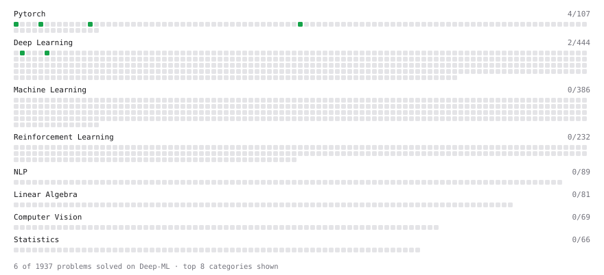

# Deep-ML

My machine learning practice from [Deep-ML](https://www.deep-ml.com). Every solution here was written by hand.

**24** solved · 20 problems · 4 labs · 0 math

[**Browse the interactive portfolio**](https://amarviswanathan.github.io/deep-ml/) to replay this filling in over time.

## Problems

| | Difficulty | Solved | |
| --- | --- | --- | --- |
| [Calculate Accuracy Score](https://www.deep-ml.com/problems/36) | easy | 2026-11-10 | [solution](problems/0036-calculate-accuracy-score) |
| [Calculate LoRA Trainable Parameter Count vs Full Fine-Tuning](https://www.deep-ml.com/problems/867) | easy | 2026-11-11 | [solution](problems/0867-calculate-lora-trainable-parameter-count-vs-full-fine-tuning) |
| [Compute a Gradient with PyTorch Autograd](https://www.deep-ml.com/problems/884) | easy | 2026-11-07 | [solution](problems/0884-compute-a-gradient-with-pytorch-autograd) |
| [Create a Float Tensor from a Python List](https://www.deep-ml.com/problems/880) | easy | 2026-11-07 | [solution](problems/0880-create-a-float-tensor-from-a-python-list) |
| [Implement Dropout from Scratch](https://www.deep-ml.com/problems/901) | easy | 2026-11-07 | [solution](problems/0901-implement-dropout-from-scratch) |
| [Implement ReLU Activation Function](https://www.deep-ml.com/problems/42) | easy | 2026-11-08 | [solution](problems/0042-implement-relu-activation-function) |
| [Implementation of Log Softmax Function](https://www.deep-ml.com/problems/39) | easy | 2026-11-06 | [solution](problems/0039-implementation-of-log-softmax-function) |
| [Leaky ReLU Activation Function](https://www.deep-ml.com/problems/44) | easy | 2026-11-10 | [solution](problems/0044-leaky-relu-activation-function) |
| [Mean Squared Error from Scratch](https://www.deep-ml.com/problems/1228) | easy | 2026-11-10 | [solution](problems/1228-mean-squared-error-from-scratch) |
| [One SGD Update Step](https://www.deep-ml.com/problems/1234) | easy | 2026-11-07 | [solution](problems/1234-one-sgd-update-step) |
| [Sigmoid Activation Function Understanding](https://www.deep-ml.com/problems/22) | easy | 2026-11-10 | [solution](problems/0022-sigmoid-activation-function-understanding) |
| [Softmax Activation Function Implementation ](https://www.deep-ml.com/problems/23) | easy | 2026-11-06 | [solution](problems/0023-softmax-activation-function-implementation) |
| [Build Scaled Dot-Product Attention](https://www.deep-ml.com/problems/490) | medium | 2026-11-10 | [solution](problems/0490-build-scaled-dot-product-attention) |
| [Epsilon-Greedy Action Selection for n-Armed Bandit](https://www.deep-ml.com/problems/158) | medium | 2026-11-10 | [solution](problems/0158-epsilon-greedy-action-selection-for-n-armed-bandit) |
| [Implement Masked Self-Attention](https://www.deep-ml.com/problems/107) | medium | 2026-11-10 | [solution](problems/0107-implement-masked-self-attention) |
| [Implement Self-Attention Mechanism](https://www.deep-ml.com/problems/53) | medium | 2026-11-08 | [solution](problems/0053-implement-self-attention-mechanism) |
| [LoRA: Low-Rank Adaptation Forward Pass](https://www.deep-ml.com/problems/222) | medium | 2026-11-11 | [solution](problems/0222-lora-low-rank-adaptation-forward-pass) |
| [SGD with Momentum Step](https://www.deep-ml.com/problems/1235) | medium | 2026-11-07 | [solution](problems/1235-sgd-with-momentum-step) |
| [Implement Multi-Head Attention](https://www.deep-ml.com/problems/94) | hard | 2026-11-10 | [solution](problems/0094-implement-multi-head-attention) |
| [Implement Multi-Head Self-Attention](https://www.deep-ml.com/problems/904) | hard | 2026-11-10 | [solution](problems/0904-implement-multi-head-self-attention) |

## Labs

| | Difficulty | Solved | |
| --- | --- | --- | --- |
| [Design Your Own Activation Function](https://www.deep-ml.com/labs/9) | easy | 2026-11-11 | [solution](labs/0009-design-your-own-activation-function) |
| [Design Your Own Attention Mechanism](https://www.deep-ml.com/labs/10) | medium | 2026-05-14 | [solution](labs/0010-design-your-own-attention-mechanism) |
| [Design Your Own Optimizer (NumPy)](https://www.deep-ml.com/labs/8) | medium | 2026-06-07 | [solution](labs/0008-design-your-own-optimizer-numpy) |
| [PyTorch: Implement Your Own Gradient Descent Training Step](https://www.deep-ml.com/labs/12) | medium | 2026-05-14 | [solution](labs/0012-pytorch-implement-your-own-gradient-descent-training-step) |

---

_This file is regenerated by Deep-ML on every push._
